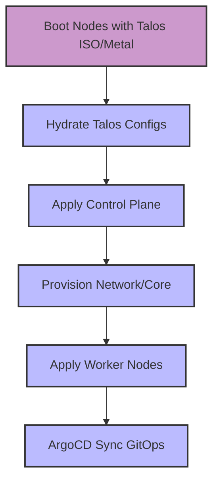

# Talos Homelab Bootstrap & Disaster Recovery Guide

This directory contains the declarative infrastructure to provision and maintain the bare metal Kubernetes cluster using Talos. It also serves as the disaster recovery (DR) playbook for rebuilding the cluster from scratch.

> **Planned power-down instead?** For a rack move or other planned full-cluster
> shutdown, use [docs/runbook-planned-shutdown.md](../docs/runbook-planned-shutdown.md) —
> nothing in this DR playbook needs to be re-run for that.

## Workflow



## Directory Structure

```text
bootstrap/
├── athena.template.zsh     # Template for athena.zsh — copy and fill in real values
├── athena.zsh              # Node IPs and cluster vars (gitignored; sourced by apply scripts)
├── mise.toml               # Tool versions (talosctl, etc.)
├── talos/
│   ├── *.template.yaml     # Committed templates with {{ dotted.key }} placeholders
│   ├── *.yaml              # Hydrated configs (gitignored, contain secrets)
│   ├── apply-control.sh    # Applies controlplane.yaml to control plane nodes
│   └── apply-worker.sh     # Applies worker.yaml to worker nodes
└── kubernetes/
    ├── provision.sh        # Installs Gateway API, Helm, Cilium, and ArgoCD (Helm chart)
    ├── cilium-values.yaml  # Cilium Helm values (single source of truth for CNI config)
    ├── argocd-values.yaml  # ArgoCD bootstrap values (adopted by cluster/core/argocd after root sync)
    └── load1p-account-token.sh # Injects 1Password Token for External Secrets
```

> **Note:** `athena.zsh` is gitignored, so a fresh clone cannot run the DR
> playbook until it is recreated from `athena.template.zsh`. Keep the real
> copy backed up outside git (e.g. in the same 1Password vault as the Talos
> secrets note).

## Order of Operations (Disaster Recovery Playbook)

If you are rebuilding the cluster (e.g., late night disaster recovery), follow these steps in exact order to ensure a stable cluster state before workloads are synced.

### 1. Pre-requisites

- Ensure your Hypervisor (Proxmox) VMs are booted with the Talos ISO.
- Run `mise install` locally to ensure `talosctl` and `kubectl` match the cluster versions.
- Ensure you are logged into the 1Password CLI (`op signin`).

### 2. Hydrate Node Configurations

Secrets are stored as a single 1Password Secure Note (item ID configured in `tools-workflow/.env` as `OP_TALOS_ITEM_ID`). The `.template.yaml` files use placeholders that map to this note.

- Navigate to your `tools-workflow` repository.
- Generate the configs:

  ```bash
  bundle exec ruby workflow.rb render-talos
  ```

- This writes the hydrated, secret-injected YAML files (e.g., `controlplane.yaml`, `worker.yaml`) into `bootstrap/talos/` alongside the templates.

### 3. Control Plane Reprovisioning

Wait for the control plane VMs to enter Talos maintenance mode.

```bash
cd bootstrap/talos
./apply-control.sh
```

Trigger the `etcd` bootstrap on the first control plane node:

```bash
talosctl --nodes $BOOTSTRAP_NODE bootstrap
```

Pull down and integrate the new cluster kubeconfig:

```bash
talosctl --nodes $BOOTSTRAP_NODE kubeconfig ~/.kube/config-athena
diff ~/.kube/config ~/.kube/config-athena
nano ~/.kube/config
```

#### Control plane VIP

`apply-control.sh` adds a Talos `Layer2VIPConfig` (address `CONTROL_PLANE_VIP`
from `athena.zsh`, on the CP VMs' `enp0s11`). The three control planes share it:
one holds it at a time, elected through etcd, and another takes it over when the
holder goes away. The LAN's DNS answers the `cluster.controlPlane.endpoint`
name with the VIP, so `kubectl` keeps working on the LAN when one control plane
is down or the WAN path to the public answer is. Public DNS keeps its own answer
for clients off the LAN.

Three things to get right:

- **The VIP is for the Kubernetes API only.** `talosctl` keeps using the node
  addresses in `talosconfig` (the VIP rides on etcd, and Talos's API must work
  when etcd doesn't).
- **The LAN's DNS answer is an A record for the VIP, never A records for the
  control planes' own addresses.** On this network a DNS name bound to a
  DHCP-reserved address is handed to that client as its DHCP hostname, and a
  Talos node takes a DHCP hostname over its generated one. A records for the
  CP addresses could rename the control planes, and with them their etcd
  members. The VIP is not a DHCP client.
- **A running cluster gets the VIP by patch, one control plane at a time**,
  not by re-running this script (which needs maintenance mode):
  `talosctl -n <cp> patch mc --patch @<vip patch> --dry-run`, then
  `--mode no-reboot`. Remove it with the same document plus `$patch: delete`.

### 4. Provision Core Infrastructure (CNI & Gateway)

*Important: Do not apply worker configurations until the CNI is established.*

```bash
cd bootstrap/kubernetes
./provision.sh
```

This script installs Gateway API, Helm, Cilium, creates the L2 announcement pool, and installs ArgoCD.
*Note: The control plane nodes will transition from `NotReady` to `Ready` once Cilium is fully running.*

### 5. Worker Node Reprovisioning

Boot your worker nodes (e.g., Raspberry Pi metal images). Once they are online and in maintenance mode, apply their configuration:

```bash
cd bootstrap/talos
./apply-worker.sh
```

Because the CNI is already active on the control plane, these nodes should successfully join and quickly transition to `Ready`.

**Worker storage.** Workers boot from SD, but their EPHEMERAL volume (all of
`/var`) goes on their NVMe via the `VolumeConfig` at the end of
`worker.template.yaml`. Placement is decided when EPHEMERAL is first created,
so a fresh worker gets it at install, provided its NVMe has free space. An
original worker's Optane still carries stale partitions until the runbook's
clear step. To move an existing worker whose
EPHEMERAL is still on the SD, use
[docs/runbook-worker-ephemeral-relocation.md](../docs/runbook-worker-ephemeral-relocation.md).
Check the placement with `talosctl -n <ip> get volumestatus EPHEMERAL`.

**Watchdog.** Every worker class also gets `watchdog.patch.yaml`, which arms
the node's hardware watchdog: a hung node resets itself (within about 15 s
of a kernel hang on a CM5, about four minutes on the GPU VM, and two minutes
after machined itself stops feeding).
The control planes get none: they have no watchdog device. Patching running
nodes, the forced-hang test and rollback:
[docs/runbook-node-watchdogs.md](../docs/runbook-node-watchdogs.md).

**CM5 worker versions change through
[docs/runbook-cm5-worker-upgrade.md](../docs/runbook-cm5-worker-upgrade.md).**
The template's `install.image` pins the Image Factory installer for the CM5
workers (`worker-cm5.schematic.yaml`, v1.14.5, by digest only). Which worker
runs what is recorded in the private infrastructure repo. Whenever
you do run `talosctl upgrade`, pass `--image` explicitly: neither the 1.13
nor the 1.14 talosctl default carries the Pi overlay.

**Use the 1.14 talosctl `mise.toml` pins.** `apply-worker.sh` renders every
node's config with `talosctl machineconfig patch`, checks that the worker
`ResolverConfig` kept its literal `domains: []` (the DHCP search-domain
override, AGENTS.md Gotcha #7), and only then applies the rendered files. A
1.13 client drops the empty list, and the script then refuses before touching
any node. Like the rest of the script, the applies use `--insecure`, so it
only works on nodes in maintenance mode (provisioning and reprovisioning).

**Scratch workers.** These are the nodes listed in `NVME_WORKER_IP`: CM5 Lites
with a 128 GB NVMe, meant for GitHub runners and other workloads that need a
lot of disk but keep nothing. They get the same `worker.yaml` plus
`worker-nvme.patch.yaml`, which adds the label `athena.asn.casa/scratch=nvme`
(no taint: see the patch for why it was dropped). `apply-worker.sh` merges the
two (see above) and applies the result. Things
to get right:

- **Same image as the other workers.** Flash exactly the image the existing
  workers run. Before applying anything, while the new node is still in
  maintenance mode, compare Tag and SHA with an existing worker. The
  maintenance API needs `--insecure`:

  ```bash
  talosctl -n <new-node-ip> version --insecure   # new node, maintenance mode
  talosctl -n <existing-worker-ip> version       # existing worker
  ```
- **Same address range.** The observability rule above applies to these nodes
  too.
- **After joining, confirm the NVMe placement:**
  - `talosctl -n <ip> get volumestatus EPHEMERAL` shows `nvme0n1`;
  - the node's `ephemeral-storage` is roughly 119 GiB, less filesystem overhead;
  - `kubectl describe node` shows the label, and no `athena.asn.casa/scratch`
    taint. A node configured before the taint was dropped still carries it.
    **Remove it by hand before applying the new config to that node live**
    (`kubectl taint node <name> athena.asn.casa/scratch=nvme:PreferNoSchedule-`):
    Talos may otherwise try to remove the taint itself, NodeRestriction refuses
    that (below), and the refusal can block the node's labels too. Not tested;
    a rebuild from maintenance mode is unaffected;
  - `talosctl -n <ip> get resolvers` shows `searchDomains: []`. This only
    means something from Talos 1.14, which applies DHCP search domains; 1.13
    ignores them, so on 1.13 it can't fail. On 1.14, check it **before any
    runner is scheduled there**: a DHCP-supplied search domain blackholes
    external API calls (AGENTS.md Gotcha #7).
- **Talos applies `nodeTaints` only at registration.** A taint added to the
  config later is refused (NodeRestriction: `not allowed to modify taints`),
  and the refusal also stops it applying labels. Found on the first GPU
  worker, 2026-10-17; see docs/runbook-gpu-node-onboarding.md. The scratch
  workers no longer carry a taint, so this now concerns the GPU workers.

**GPU workers.** These are the nodes listed in `GPU_WORKER_IP` (as `<ip>:<gen>`):
amd64 boxes with an Intel iGPU for the spritz video transcoder, on a Secure Boot
Image Factory image (`worker-gpu.schematic.yaml`), with `worker-gpu.patch.yaml`
on top of `worker.yaml`. That patch sets the install disk and swap on the Optane,
EPHEMERAL on the SATA SSD, and a hard `spritz.dev/gpu=intel:NoSchedule` taint.
Onboarding, including the one-time manual taint Talos cannot apply itself:
[docs/runbook-gpu-node-onboarding.md](../docs/runbook-gpu-node-onboarding.md).

**Worker names are fixed: `athena-<arch>-<last octet of the address>`.** `apply-worker.sh`
adds a `HostnameConfig` per node (`arm64` for the CM5 lists, `amd64` for the GPU lists), computed
from `athena.zsh` at render time, so no name is committed here. A fixed name survives a rebuild;
Talos's default (`auto: stable`) derives the name from the machine's identity, so every rebuild
used to register a new node and leave the old `Node` object behind. Two consequences:

- **The first apply to a node still on an auto name renames it.** It registers as a new `Node`;
  drain it first, then delete the old `Node` object.
- **On a rebuild, delete the old `Node` object before applying**, so the new machine registers
  fresh under the same name instead of inheriting a stale object
  (`docs/runbook-cm5-worker-upgrade.md`, steps 5 and 6).

The control planes keep their names (`apply-control.sh` is unchanged).

**Worker addresses are not a free choice.** Observability lives outside the
cluster, and the stores accept telemetry only from a defined range of node
addresses — cluster egress masquerades, so a Vector pod arrives as its node
address. Take the current range from the infrastructure repo before assigning
one. A worker outside it looks completely healthy while shipping nothing:
Vector stays `Ready` and buffers. `AthenaNodeLogsGone` catches that within 15
minutes.

### 6. GitOps Workload Sync (ArgoCD App of Apps)

ArgoCD is now running, but it cannot sync workloads from GitHub until the External Secrets Operator is authenticated to 1Password.

1. **Inject 1Password Credentials:**
   Export your active 1Password Service Account Token, then run the loader (the token is read from the environment — never edit it into the script):

   ```bash
   export OP_SERVICE_ACCOUNT_TOKEN="$(op read 'op://<vault>/<item>/credential')"
   cd bootstrap/kubernetes
   ./load1p-account-token.sh
   cd ../../
   ```

2. **Apply the Root Application:**
   Instead of applying manifests manually, apply the top-level "App of Apps". This single command tells ArgoCD to recursively sync both `cluster/core` (External Secrets Operator) and `cluster/apps` (Workloads). ArgoCD respects sync waves, ensuring CRDs are installed before secret manifests are parsed.

   ```bash
   kubectl apply -f cluster/root.yaml
   ```

   *(Note: You may see a `metadata.finalizers` warning from Kubernetes about the `resources-finalizer.argocd.argoproj.io` format. This is a harmless Kubernetes validation warning that can be safely ignored).*

The cluster is now fully rebuilding itself declaratively. Grab a coffee and watch the sync via the ArgoCD UI.
